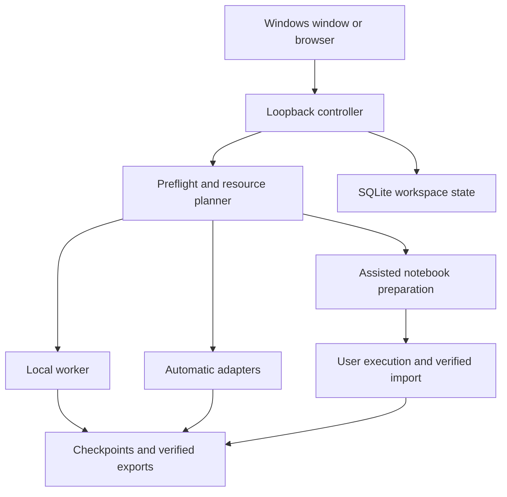

# MultiGPU

MultiGPU is a local application for training models with **your own computer and your own provider accounts**, then saving verified models on your computer. It provides a Windows desktop window, in-app provider setup, a training wizard, progress monitoring, checkpoint recovery and model export.

**Application version: 0.4.3. Official-source provider research checked: 24 October 2026.**

The goal is to make eligible free compute easier to use without changing the user's training target or silently enabling paid resources. The current implementation trains each attempt on **one resource at a time**. Ordered fallbacks and compatible checkpoints support continuation; synchronous cross-provider training and pooled GPU memory are future work.

> Free CPU, free GPU, introductory credits and a paid subscription's included credits are different offers. Published offers do not establish an account's actual entitlement, available capacity or zero-bill protection. Read the [provider audit](docs/PROVIDER_RESEARCH.md) before choosing resources.

## Contents

- [Capabilities](#capabilities)
- [Free and paid providers](#free-and-paid-providers)
- [Installation](#installation)
- [Training workflows](#training-workflows)
- [Recipes and data](#recipes-and-data)
- [Dependencies and provider setup](#dependencies-and-provider-setup)
- [Spending and fallback rules](#spending-and-fallback-rules)
- [Progress and recovery](#progress-and-recovery)
- [Model export and prediction](#model-export-and-prediction)
- [Custom training scripts](#custom-training-scripts)
- [Architecture and storage](#architecture-and-storage)
- [Local API](#local-api)
- [Security and trust](#security-and-trust)
- [Development and testing](#development-and-testing)
- [Windows packaging](#windows-packaging)
- [Troubleshooting](#troubleshooting)
- [Validation and next work](#validation-and-next-work)

## Capabilities

Implemented:

- Local CPU and compatible NVIDIA CUDA training with explicit device/GPU selection.
- Dependency-free tabular classification, a small PyTorch network, image transfer learning and trusted custom Python scripts.
- Automatic connector code for Kaggle, Modal Functions/Volumes and dedicated Lightning Studios.
- Assisted notebooks, optional input payloads, in-app instructions and verified result import for eligible services.
- Persisted drafts, explicit resource order and preview digests binding launch to reviewed inputs/resources.
- Metrics, worker heartbeats, five-minute summaries and redacted diagnostic logs.
- Atomic checkpoints, compatible continuation and recovery after interrupted model delivery.
- Verified exports, artifact downloads, held-out evaluation and built-in prediction examples.
- Windows tray, native file dialogs, external sign-in, notifications and browser/controller recovery.

The directory contains resources with different integration levels. It does not certify every account, GPU, plan or workload. A general model marketplace, arbitrary-model graphical trainer, hosted multi-user service, automatic tuning and a qualified cross-provider distributed cluster are not implemented.

## Free and paid providers

The table is the **research classification**, not a live entitlement check. A provider can belong to several cost groups. Detailed conditions, official citations and conflicting evidence are in [docs/PROVIDER_RESEARCH.md](docs/PROVIDER_RESEARCH.md).

| Resource | Training cost category | Current app integration |
|---|---|---|
| Kaggle Notebooks | Published free CPU/GPU allowance; quota/capacity apply | Automatic CLI quota/submission/status/logs/output; immediate stop in provider console |
| Google Colab | Dynamic free CPU/GPU; separate paid products | Assisted notebook/import |
| Databricks Free Edition | Free CPU; conditional non-commercial GPU | Assisted; account/runtime restrictions apply |
| Modal | Recurring compute credits, then metered usage; GPU payment condition | Automatic Functions/Volumes; hosted notebooks retired |
| Lightning AI Studios | Free CPU; eligible starting GPU credits; paid GPU afterward | Dedicated Studio adapter with explicit shutdown authorization |
| Deepnote | Free CPU / paid GPU | Assisted notebook; API automation not implemented |
| Hex | Free CPU / paid GPU | Assisted notebook; API automation not implemented |
| JetBrains Datalore | Free CPU / paid GPU | Assisted; free-CPU API candidate, not implemented |
| Fastero | Free notebook compute; GPU/hardware unverified | Development information; outside training pool |
| GitHub Codespaces | Included CPU development allowance / paid overage; no general GPU | Repository-development helper, outside general training pool |
| Paperspace Notebooks | Paid confirmed; new-account free availability unresolved | Assisted; never assume an available free machine |
| Colab Enterprise | Metered cloud compute; eligible credits may offset charges | Assisted, user-owned billing/IAM project |
| JupyterHub | Institution/operator-provided hardware | Assisted on an authorized Hub |
| Your computer | User-owned CPU/CUDA resources and operating costs | Automatic local execution |

**Free GPU starting points:** Kaggle and consumer Colab, within their restrictions. Databricks GPU is conditional. Modal belongs in recurring credits; Lightning's GPU grant is introductory. Deepnote, Hex and Datalore should not appear under a filter meaning free GPU training.

**Paperspace:** official pages still contain free-machine claims, but current new-account access was not established. Treat it as paid/free-unverified rather than promise a free M4000. The [evidence trail](docs/research/providers-gpu-2026-10-24.md#paperspace-evidence-and-unresolved-availability) records the conflict.

**Research versus installed app:** this documentation update does not rebuild the 0.4.3 installer. Historical embedded provider text can lag this audit. Directory cost tags and eligibility need to be synchronized in a subsequent implementation; the research records those corrections. App support and actual account qualification remain separate.

## Installation

### Windows release

The packaged application targets **Windows 10/11 x64**. Install the release and open **MultiGPU** from the Start menu. A local build is `dist/MultiGPU-0.4.3-Setup.exe`; `dist/release-info.json` and `dist/acceptance-results-0.4.3.json` identify its hashes and checks when these artifacts are present.

The installer includes CPython, uv, the launcher and native host components. A system Python is not required. Optional training/provider libraries are prepared later, on request, in the app's environment.

Microsoft Edge WebView2 Evergreen Runtime is required. If missing, the launcher explains it and offers a Microsoft-signed bootstrapper with consent; network access is required. Installation is per-user without administrator elevation. Current installers are unsigned; clean-machine first-install qualification remains outstanding.

| Content | Default Windows location |
|---|---|
| Program | `%LOCALAPPDATA%\Programs\MultiGPU` |
| App Python environment | `%LOCALAPPDATA%\MultiGPU\environment` |
| Workspace | `%LOCALAPPDATA%\MultiGPU\workspace` |
| Exports | `exports/` inside the chosen workspace |

Choose another workspace in the tray for the next start. Closing the window hides it in the tray while work can continue. Use **Pause training and exit** deliberately. Remote execution can outlive the controller; inspect provider stop controls and unresolved-attempt warnings before assuming billing ended.

### Source dashboard

Python **3.11+** is required. From the repository root:

```powershell
python -m venv .venv
.\.venv\Scripts\Activate.ps1
python -m multigpu --no-browser
```

Open `http://127.0.0.1:8765`. The dashboard and CPU starter have no third-party Python dependencies. Optional `python -m pip install -e .` also installs the `multigpu` console command.

The browser dashboard can run on other suitable Python systems, but native window/dialogs/tray and release packaging target Windows. Other operating systems are not equivalent release qualifications.

### Source desktop and controller options

An unprepared source checkout needs an existing suitable Python and native preparation:

```powershell
.\packaging\prepare-native.ps1
.\start.cmd
```

The source launcher creates/reuses `.venv` from available Python; it does not automatically install a system Python. Terminal/browser development can use:

```powershell
.\start.ps1 -Port 8765 -NoBrowser -DataDir C:\MultiGPU\development-workspace
```

```text
python -m multigpu [--port PORT] [--data-dir DIRECTORY]
                   [--no-browser] [--connection-file FILE]
```

`--port` defaults to 8765; 0 requests an available loopback port. `--data-dir` defaults to `MULTIGPU_HOME`, otherwise relative `.multigpu`. `--no-browser` suppresses browser opening. `--connection-file` writes the chosen URL, process ID and workspace for a launcher. The packaged desktop chooses an available loopback port. Only one controller can own a workspace.

## Training workflows

### Local first run

1. Open **New training**, use the generated tabular sample and dependency-free recipe.
2. Name the run and inspect settings/data.
3. Choose **Your computer**, CPU/Auto and free-only execution.
4. Preview the exact plan; resolve preflight errors, then start.
5. Inspect loss, checkpoint and held-out evaluation.
6. Verify/export the model and try a prediction with its saved feature schema.

The generated sample demonstrates the workflow; its accuracy is not evidence for a real application.

### Own data and GPU

The wizard follows **Task & data → Training → Compute & limits → Review**. Choose a supported CSV/image directory, inspect it, select a compatible recipe/device and prepare dependencies.

GPU detection and CUDA readiness are separate. Explicit CPU preparation stays CPU. Image preparation follows CPU/CUDA choice; Auto can choose CUDA when NVIDIA hardware is detected. Detection does not prove compatible drivers, sufficient VRAM or success for a particular model.

Drafts persist across navigation/restart. Paid-execution and script-trust confirmations reset on restored/repeated drafts. **Repeat settings** creates an editable draft without launching work.

### Automatic providers

Follow the in-app checklist: open the provider account, prepare its client in the app environment, finish native sign-in, enter nonsecret settings, then **Save & check**. Identity, quota, requested hardware and spending admission are separate observations.

- **Kaggle:** bounded notebook submission, durable identity, quota/status/logs and output retrieval. Immediate stopping uses Kaggle's control.
- **Modal:** detached Function plus persistent artifact Volume; the retired notebook editor is not used.
- **Lightning:** dedicated Studio, requested machine and explicit permission to stop after collection.

These are implemented code paths, not live certification of all plans/hardware/billing controls.

### Assisted providers

Instructions stay inside the app. The downloads are actual training inputs: `training.ipynb` and, for some large/image jobs, `training-payload.zip` containing code/data/recovery assets.

1. Create the assisted run and review the provider guide.
2. Download the notebook and any required payload.
3. Open the provider notebook yourself, choose entitled compute and upload inputs.
4. Run the cells while watching provider runtime and billing limits.
5. Run **Save results** and download `multigpu-results.zip`.
6. Preview/verify it in the app, then import into the same job.

Manual notebooks do not provide guaranteed live telemetry to the controller. Imported history/timestamps are labelled as recorded observations, not independently observed live activity. The app cannot stop or enforce billing for manually managed runtimes.

## Recipes and data

| ID | Model/task | Runtime |
|---|---|---|
| `starter` | Numeric binary classification, logistic classifier | CPU; Python standard library |
| `pytorch` | Numeric binary classification, small 16-unit network | PyTorch CPU or selected CUDA GPU |
| `image` | Frozen ImageNet ResNet-18 backbone and trainable classification head | Torch/torchvision/Pillow; CPU or CUDA |
| `custom` | User `train(ctx)` entry point | Trusted code, user-managed dependencies/state |

New runs use recipe format version 2. Legacy version-1 jobs preserve their original data/evaluation semantics. Tabular wizard defaults are 500 steps, batch 32, learning rate 0.05, seed 42 and 30-minute sessions. Image defaults are five epochs, batch 16 and learning rate 0.001; step target is derived from batches/epochs.

The image recipe trains only the new head. Arbitrary architectures, language-model fine-tuning and large streaming jobs require custom code and suitable hardware.

### CSV inputs

```csv
age,income,label
21,35000,0
46,92000,1
```

This shows the format only: actual training requires at least **five rows per class**. Features must be finite numeric values; labels binary 0/1. Missing/text features are rejected. A complete text header is optional; choose a label name or zero-based index, defaulting to the last column.

Version 2 uses seeded stratified 80/20 validation and training-only standardization, saved with the model. Limits include a 256 MiB CSV, one million rows and approximately 512 MiB estimated in-memory data. Larger inputs need custom streaming code. The generated demo contains 512 rows/four features.

### Image inputs

```text
images/
  cats/
    cat-001.jpg
    ...
  dogs/
    dog-001.jpg
    ...
```

Provide at least two classes and five readable images per class. PNG/JPEG/BMP/WebP/TIFF are accepted, up to 50,000 images; individual images above 40 megapixels are rejected. The saved transform uses RGB, resize/crop to 224 pixels and ImageNet normalization.

Official base weights are downloaded during explicit preparation and checked against the pinned SHA-256. All inputs must fit documented host-memory/staging limits; GPU batches are transferred individually.

## Dependencies and provider setup

Use the app's preparation buttons so packages reach the controller's actual interpreter. Profiles are `cpu`, `image`, `cuda`, `kaggle`, `modal` and `lightning`. Image preparation is device-aware and includes verified base weights. Setup tasks/logs persist, support cancellation and require repair/rechecking after interruption.

Version 0.4.3 preparation pins Torch 2.14.1, torchvision 0.29.1 and Pillow 12.3.0; CUDA uses `cu130` builds from the official index. See [environment.py](multigpu/environment.py) for exact package/index choices. Optional project extras also exist in [pyproject.toml](pyproject.toml).

Authentication stays in provider-native tools. Supported Windows sign-in buttons open their console/browser. The displayed commands target the app environment, not an unrelated terminal's Python. Connection forms store nonsecret settings, not pasted passwords/tokens.

## Spending and fallback rules

Users buy plans directly from providers. MultiGPU does not purchase plans or silently activate paid fallback. Keep published offer, native account identity, actual entitlement/allowance and app qualification separate.

Free-only is the default. Current automatic admission supports local resources and eligible observed Kaggle quota. Modal/Lightning free-only automation stays blocked because the app cannot independently verify zero out-of-pocket enforcement for the planned run and relevant ancillary charges. That app limitation does not remove the providers' published credit offers.

Paid automatic execution requires a new job-level choice, positive cap and appropriate provider/account settings. A saved provider limit is a user report, not independently verified billing evidence. A local timer or credit balance alone cannot establish a zero provider bill.

Multiple selected providers define primary resource and ordered fallbacks. Compatible continuation preserves the original target; it does not launch unrelated experiments or silently reduce epochs. Uncertain remote attempts reserve their account until reconciled, preventing blind duplicate submissions.

## Progress and recovery

### Observations

Worker heartbeats occur approximately every 30 seconds; five-minute summaries every 300 seconds. Summaries show progress/loss, device, allowance confidence, checkpoint and required action. Short, terminal and imported sessions also receive immediate summaries.

Built-in recipes checkpoint about every 60 seconds at cooperative points and at pause/completion. They cannot guarantee a save inside a long optimizer step. Custom scripts must call their own checkpoint hook. Controller connectivity, last worker event, last training progress and imported-history timestamps stay separate; a connected account does not prove a GPU is running.

### Checkpoint continuation

Checkpoints bind job identity, data fingerprint, recipe/version, target and saved progress/state. Built-in PyTorch/image recovery includes relevant model, optimizer, RNG and cursor information. Portable state is validated and limited to 64 MiB; image assets are referenced separately.

| Action | Behavior |
|---|---|
| Save & pause | Ask a cooperative worker to checkpoint and stop training |
| Resume on this computer | Validate compatible inputs/resources, then continue locally |
| Continue with a notebook | Review a selected eligible assisted resource and exact checkpoint/target |
| Finish evaluation and export | Complete delivery on local CPU from a full-target built-in checkpoint, without more optimizer updates |
| Recover previous checkpoint | Validate retained previous recovery state |
| Relink identical inputs | Locate moved originals through content identity |

Unobservable previous notebook sessions need explicit stopped-session confirmation. Changed checkpoint/configuration/target invalidates the reviewed digest. Older imports require rollback consent. Built-in finalization does not provide a generic recovery implementation for arbitrary custom models.

### Notebook reruns and Drive

Generated notebooks use job-scoped folders and a subprocess worker. Reruns resume the newest compatible verified checkpoint or reuse a verified completed model. Result archives contain the current export/recovery files, excluding backup exports and locks.

Colab notebooks offer optional, **disabled-by-default** recovery to a Drive folder the user explicitly mounts and selects. Checkpoints are copied into immutable, verified committed folders; earlier copies remain. Configured persistence failure pauses training while retaining a local checkpoint. That pause does not stop provider compute. Without durable recovery, provider VM deletion can remove local session files.

### Uncertain remote attempts

If launch acknowledgment is lost, the app preserves the submission identity and blocks blind retries. **Check provider state** reconciles it. **Resolve provider launch** can attach independently verified execution evidence or record the user's explicit console confirmation that an attempt stopped/was absent; user-confirmed evidence is labelled accordingly.

An absent training process does not prove a Lightning Studio stopped. Kaggle immediate stopping remains a provider-console operation. Remote recovery artifacts remain until local verification; cleanup is user-controlled.

## Model export and prediction

Delivery checks paths, hashes, job/input identity and required files before saving the local copy. Downloads and built-in prediction verify files again. Remote retention and local verification are separate facts.

Typical tabular export:

```text
manifest.json
model.json
checkpoint.json
evaluation.json
input_schema.json
training.json
README.txt
predict.py
multigpu_runtime/
```

Image exports add their verified base-weight asset and preprocessing/class metadata. Exact files vary by recipe. Custom scripts choose their export files; valid custom artifacts do not automatically have a generic UI inference adapter.

From an exported model directory:

```powershell
python predict.py --features '[0.1, 0.2, 0.3, 0.4]'
python predict.py --image C:\data\example.jpg
```

Use feature names/order/count from `input_schema.json`; the numeric example matches the generated four-feature demo. Built-in tabular prediction needs only Python, including exports from the small PyTorch recipe. Image prediction uses CPU and requires Torch/torchvision/Pillow. Held-out metrics and probabilities are estimates, not guarantees on future data.

## Custom training scripts

Choose **Custom PyTorch / Python** and a trusted file implementing `train(ctx)`. A complete working example is [examples/custom_train.py](examples/custom_train.py): a dependency-free toy regressor demonstrating the hooks, not a PyTorch model implementation.

| Context member | Responsibility |
|---|---|
| `ctx.spec` | Validated settings and original target |
| `ctx.output_dir`, `ctx.device`, `ctx.gpu_index` | Output location and reported execution information |
| `ctx.step`, `ctx.loss` | Current reported progress |
| `ctx.resume_state` | Previous custom payload when resuming |
| `ctx.should_stop()` | Frequently check pause/session limits |
| `ctx.report(loss, step=None, **metrics)` | Finite loss and monotonic bounded progress |
| `ctx.checkpoint(state)` | Save a JSON-serializable resumable payload |
| `ctx.export(files)` | Map safe relative paths to bytes, text or source `Path` values |

Save model, optimizer, data cursor/sampler, RNG and other state needed for faithful resume. Checkpoint the latest reported step before returning, even if stopped before the first update. An early return without a stop or completion without required checkpoint/export is an error. Custom scripts own evaluation, dependencies, resource use and model-specific inference.

Custom Python runs with the user's permissions. Per-run trust resets on restored drafts; automatic providers also require custom-script authorization. This is not an untrusted-code sandbox.

## Architecture and storage

The frontend is plain HTML/CSS/JavaScript. Python's standard-library HTTP server and SQLite form the backend; training/provider packages are optional. The Windows application hosts the same local UI using .NET Framework/WebView2.



### Source map

Paths below are inside [multigpu/](multigpu/).

| Module | Role |
|---|---|
| `server.py` | Routes, session/Origin guards, static files |
| `service.py` | Lifecycle, drafts, setup, reconciliation and delivery |
| `catalog.py`, `planner.py` | Directory/capabilities, recipe validation, resource and spending admission |
| `connectors.py`, `onboarding.py` | Native clients/staging/collection and in-app instructions |
| `environment.py`, `process_control.py` | Persistent dependency setup and owned Windows process trees |
| `worker.py`, `recipes.py`, `datasets.py` | Training contract, algorithms and inputs/assets |
| `notebook_runtime.py` | Isolated sessions, reruns, durable recovery and packaging |
| `artifacts.py`, `imports.py`, `prediction.py` | Integrity, result import and supported inference |
| `store.py` | SQLite persistence and workspace ownership lock |
| `desktop.py` | Controlled native dialogs/sign-in/open-folder actions |
| `benchmark.py` | Same-host two-GPU benchmark, not cross-provider qualification |
| `static/` | Frontend presentation and interactions |

[packaging/](packaging/) contains native window/launcher and installer tools; [tests/](tests/) contains backend/browser regressions; [docs/](docs/) contains the provider research; [examples/](examples/) contains custom integration code.

Workspaces contain `state.sqlite3`, SQLite journal files, `controller.lock`, job-specific specs/events/checkpoints/assets, cache, diagnostic logs and default `exports/`. Schema-version-two migration retains `state.before-v2.sqlite3`. Local storage is not promised to be encrypted at rest.

Credentials remain in native provider configuration. The app stores nonsecret settings and observed account/allowance evidence. Back up important exports and the workspace consistently; copying only a live main SQLite file can omit WAL state. Prefer a stopped controller or a proper SQLite backup procedure.

## Local API

This is trusted local controller infrastructure, not a public/multi-tenant service. It binds `127.0.0.1`. `/api/bootstrap` returns the session token in `X-MultiGPU-Token`; JSON mutations require it. Host, Origin and cross-site checks apply. Another process running as the same user remains inside the trust boundary.

| Method | Route/group | Purpose |
|---|---|---|
| GET | `/api/bootstrap`, `/api/hardware`, `/api/jobs`, `/api/jobs/:id` | Workspace, hardware and run observations |
| GET/POST | `/api/draft`, `/api/providers/:id/setup`, `/api/jobs/:id/setup` | Draft/checklist progress |
| POST | `/api/datasets/inspect` | Data validation before execution |
| POST | `/api/jobs/preview`, `/api/jobs` | Preview, then create with matching digest |
| POST | `/api/providers/:id/probe` | Native account/resource evidence |
| POST | `/api/environment/setup` | Explicit preparation profile/device |
| GET | `/api/environment/tasks`, `/api/environment/tasks/:id` | Persistent setup observations |
| POST | `/api/environment/tasks/:id/cancel` | Cancel setup |
| POST | `/api/jobs/:id/pause`, `cancel`, `resume`, `reconcile` | Supported lifecycle actions |
| POST | `/api/jobs/:id/continue-guided`, `finish-delivery` | Preview/commit checkpoint-bound recovery |
| POST | `/api/jobs/:id/resolve-submission`, `relocate-inputs`, `recover` | Resolve attempts and recover verified state |
| POST | `/api/jobs/:id/import`, `export`, `predict`, `archive` | Delivery, inference and history |
| GET | `/api/jobs/:id/notebook`, `notebook-payload`, `bundle`, `artifacts` | Supported training assets/model downloads |
| GET | `/api/diagnostics/logs` | Redacted diagnostics |
| POST | `/api/settings`, `/api/cache/cleanup`, `/api/shutdown` | Settings, disposable cleanup and exit |

Short action names share `/api/jobs/:id/`. Use `allowed_actions` from the current job; state and capabilities can forbid an operation. [server.py](multigpu/server.py) and [service.py](multigpu/service.py) define the complete routes/payload checks.

Example for an intentionally isolated local controller:

```powershell
$base = 'http://127.0.0.1:8765'
$bootstrap = Invoke-WebRequest -UseBasicParsing -Uri "$base/api/bootstrap"
$headers = @{
    'X-MultiGPU-Token' = [string]($bootstrap.Headers['X-MultiGPU-Token'] | Select-Object -First 1)
}
$spec = @{
    name = 'Local API example'
    recipe = 'starter'
    providers = @('local')
    steps = 50
    device = 'cpu'
    free_only = $true
}
$plan = Invoke-RestMethod -Method Post -Uri "$base/api/jobs/preview" `
    -Headers $headers -ContentType 'application/json' -Body ($spec | ConvertTo-Json)
# Review $plan, especially preflight errors and selected resource, before creating.
$spec.preview_digest = $plan.preview_digest
$job = Invoke-RestMethod -Method Post -Uri "$base/api/jobs" `
    -Headers $headers -ContentType 'application/json' -Body ($spec | ConvertTo-Json)
$job.id
```

Creation starts a local CPU job; it demonstrates no cloud entitlement. Changed inputs/configuration require another preview.

## Security and trust

- Keep passwords, payment details and API secrets in provider-native tools, not connection forms or shared screenshots.
- Diagnostics preserve actionable errors with credential redaction. Review logs before sharing; redaction is not permission to include secrets.
- Imports validate paths, identities, finite values, size bounds and hashes. Hashes establish consistency, not the trustworthiness of arbitrary code/models.
- The native WebView permits the exact controller origin, routes approved external HTTPS navigation to the normal browser and blocks unsafe origins/schemes. Native dialogs handle file selection/downloads.
- Windows setup children join Job Objects so cancellation/controller crashes do not intentionally leave detached installers running. Custom training still needs cooperative stopping.
- Provider staging contains selected inputs. Inspect notebook/payload contents and provider privacy settings before upload.
- Do not expose the controller as a shared internet API or treat its session token as multi-user authorization.

## Development and testing

Use disposable workspaces, not installed user data. Python 3.11+ runs the core; optional recipe/provider tests need their dependencies. Cloud interface fixtures and real local training test different claims.

```powershell
python -m unittest discover -s tests -p 'test_*.py' -q
```

Version 0.4.3 recorded **230 passing tests, no skips**, in its prepared environment. Fresh environments can skip optional-library/platform-specific cases. See [VALIDATION.md](VALIDATION.md) for evidence and conditions.

Browser tests require Node, Playwright and Chrome. Use an isolated loopback controller on an unused port other than 8765, with a workspace **inside `.test-runs/`**; delivery/recovery tests reject other workspace locations. Start it in a separate terminal:

```powershell
python -m multigpu --port 8768 --data-dir .test-runs/browser-state --no-browser
```

Set `MULTIGPU_TEST_URL` to that test controller. Some suites need the completed local fixture from `browser-smoke.cjs`; full smoke/image coverage also needs prepared image libraries/official weights. Delivery additionally needs an absolute `MULTIGPU_TEST_PYTHON` for executing generated notebook code. Artifacts go under `.test-runs/`.

```powershell
$env:MULTIGPU_TEST_URL = 'http://127.0.0.1:8768'
$env:MULTIGPU_TEST_PYTHON = (Resolve-Path .venv\Scripts\python.exe).Path
node tests/browser-smoke.cjs
node tests/browser-contract.cjs
node tests/browser-setup.cjs
node tests/browser-journey.cjs
node tests/browser-delivery.cjs
node tests/browser-recovery.cjs
node tests/browser-provider-tools.cjs
node tests/browser-provider-observations.cjs
```

`python -m multigpu.benchmark --output benchmark.json` measures a synthetic same-host DDP workload when two CUDA GPUs and an NCCL-compatible environment are available. It does not qualify a multi-provider cluster or promise speedup for a real model.

## Windows packaging

See [packaging/README.md](packaging/README.md) for prerequisites and acceptance details.

```powershell
.\packaging\prepare-compiler.ps1
.\packaging\build-windows.ps1 -Version 0.4.3
.\packaging\test-payload.ps1
.\packaging\test-native-helpers.ps1
.\packaging\test-native.ps1
```

The pinned toolchain includes CPython 3.12.15, uv 0.12.22, WebView2 SDK 1.0.4258.31 and Inno Setup 6.7.3. The build verifies tool hashes/signatures, uses an explicit file allowlist and records payload/installer hashes. GPU libraries, datasets, credentials, exports and the state database are not part of the base payload.

Payload tests relocate the exact app and exclude system Python. Native tests isolate download/clipboard/navigation/recovery/second-launch checks. `test-installer.ps1` exercises install/uninstall but refuses to replace an existing registered installation.

Upgrade/uninstall are designed to retain workspace, environment, exports, WebView profile and native credentials. Environment repair keeps a backup and rolls back failures; optional dependencies must be prepared again. These behaviors still need clean-Windows and actual upgrade/uninstall qualification.

No project-level `LICENSE` file is currently included. Third-party notices remain in payload runtime/native/licenses directories and [packaging/licenses/](packaging/licenses/).

## Troubleshooting

| Symptom | Check/recovery |
|---|---|
| Tools installed but guide blocked | Recheck setup in the same environment; installation does not verify an account. Inspect task logs. |
| Account connected, training unavailable | Inspect quota, hardware, plan and free-only blockers separately. |
| No free Paperspace machine | Keep availability unknown; do not choose a paid machine to satisfy free-only. Consult the recorded documentation conflict. |
| Modal notebook unavailable | Use the Functions connector if admitted or another assisted provider; recover existing output by import. |
| NVIDIA detected, CPU used | Choose a GPU-capable recipe/device and prepare CUDA in the controller environment; inspect actual reported device. |
| Client works only in another terminal | Prepare/sign in through the app or its exact displayed interpreter. |
| Kaggle launch error | Read redacted diagnostics and provider account/quota/console; reconcile uncertain attempts before retry. |
| Manual notebook has no live data | Watch its notebook, then save/download/import results. |
| Import fails | Inspect job/fingerprint/target/hash, incomplete copies, multiple exports and path restrictions; preserve originals. |
| Runtime expired | Import a saved compatible checkpoint and review continuation; configured Drive recovery must have committed successfully. |
| Target reached, export failed | Finish evaluation/export from a supported full-target checkpoint; check disk/permissions. |
| Controller/window disconnected | Reload/reconnect/restart and inspect diagnostics; provider compute can continue. |
| Second controller rejected | Reopen the existing controller or choose another workspace; do not remove an active ownership lock. |

## Validation and next work

[VALIDATION.md](VALIDATION.md) records exact releases, hashes and checks. Version 0.4.3 passed 230 Python tests, three affected browser suites and bundled-payload CPU training/export/restart. Retained 0.4.2 evidence includes native Windows host/helper tests and real RTX 5050 Laptop CUDA tabular/image training, exact resume, export and standalone prediction.

Local and fixture tests do not certify live provider lifecycle/billing, real Colab/Drive persistence after VM deletion, every GPU/driver or clean Windows first-install behavior. Research establishes published offers, not those execution paths. The research/README update itself does not create a new installer or claim fresh training tests.

Next work, tracked in [IMPLEMENTATION_PLAN.md](IMPLEMENTATION_PLAN.md):

1. Synchronize cost tags/filters/eligibility with the official-source audit, retaining documented uncertainty.
2. Qualify authorized live provider launch, observations, quota exhaustion, interruption, cancellation and usable local export.
3. Independently verify billing protection before enabling more automatic free-only modes.
4. Qualify real notebook recovery, package/network limits and allocated hardware.
5. Complete clean Windows/WebView2, upgrade/uninstall and installer signing.
6. Benchmark permitted parallel training before admitting it; selecting providers alone does not establish a compatible efficient cluster.

Contributions should follow the current architecture and [design context](DESIGN.md), retain credential/target/preview/retention protections, add focused regressions for material logic and state what each check actually proves.
